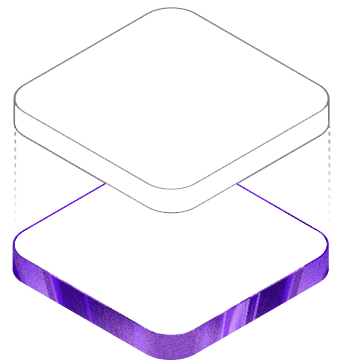

# 🧠 LIAB – The AI Operating System for Student Success

> **Google Gemma 4 Hackathon Submission**  
> *Developed by [Abdurrahman Sudais](https://github.com/Abdurrahman-Sudais) & [Awwal Adepoju](https://github.com/D-Data-alchemist)*



---

## 📌 Executive Overview

**LIAB** (*Learn. Improve. Achieve. Belong.*) is a context-aware **AI Operating System for Students**. 

Today, students juggle fragmented single-purpose tools—one for PDF notes, another for coding practice, another for study scheduling, and another for focus timers. LIAB unifies these academic workflows into a single workspace powered by a **shared neural memory store** and **Google’s Gemma 4 LLM**.

Every document uploaded, code snippet debugged, or study session completed updates a central context layer in Firestore—allowing Gemma 4 to act as a proactive, personalized academic co-pilot.

---

## 🌟 Key Features

### 📚 1. Learn (Document RAG & Active Recall)
- **Client-Side PDF Extraction**: Instant client-side text parsing using `pdfjs-dist`.
- **Gemma 4 RAG Summaries**: Structured summaries detailing Key Concepts, Definitions, and Essential Takeaways.
- **Automated Quiz Generation**: Instant 5-question multiple-choice quizzes with explanations and score tracking.
- **Interactive Flashcards**: 3D flipping flashcard decks for active recall study.

### 💻 2. Build (Code Intelligence)
- **Automated Code Debugging**: Split-pane analyzer providing root-cause explanations, corrected code blocks, and practice problem synthesis.
- **Technical Q&A**: Real-time programming assistant for algorithms, data structures, and system design queries.

### 📅 3. Study Planner (7-Day Schedule Engine)
- **Document-Linked Schedules**: Automatically generates a 7-day study plan mapped directly to your uploaded PDF lecture notes and upcoming exams.

### 🎯 4. Balance (Wellness & Focus Timer)
- **Monochromatic Pomodoro Clock**: Clean SVG circular timer with customizable focus & break intervals.
- **Mood Check-ins**: Personalized AI wellness tips based on study duration and student fatigue levels.
- **Evidence-Based Techniques**: Quick guides for Feynman Technique, Active Recall, Spaced Repetition, and Mind Mapping.

### 🧭 5. Campus Guide
- **Smart Campus Q&A**: Answers university life, study space booking, and student service inquiries.
- **Real-Time Library Occupancy**: Live metrics tracking library capacity and quiet zones.

---

## 🛠️ Tech Stack & Architecture

- **Frontend Core**: React 18, Vite, JavaScript (ES6+), React Router DOM v6
- **Styling Design System**: Custom Architectural Dark Theme (`Plus Jakarta Sans`, `JetBrains Mono`, Raycast/Linear UI layout)
- **AI / LLM Engine**: **Google Gemma 4 (`gemma-4-31b-it`)** via Google AI Studio API
- **Backend & Database**: Firebase Authentication, Firestore Database, Firebase Storage
- **PDF Processing**: `pdfjs-dist` (Client-side fast extraction)

---

## 🚀 Local Development Setup

### 1. Clone Repository & Install Dependencies
```bash
git clone https://github.com/Abdurrahman-Sudais/cloud-cyborgs--LIAB.git
cd cloud-cyborgs--LIAB
npm install
```

### 2. Configure Environment Variables
Create a `.env.local` file in the root directory:
```env
VITE_FIREBASE_API_KEY=your_firebase_api_key
VITE_FIREBASE_AUTH_DOMAIN=your_project.firebaseapp.com
VITE_FIREBASE_PROJECT_ID=your_project_id
VITE_FIREBASE_STORAGE_BUCKET=your_project.appspot.com
VITE_FIREBASE_MESSAGING_SENDER_ID=your_sender_id
VITE_FIREBASE_APP_ID=your_app_id

# Google AI Studio (Gemma 4) Key
VITE_GEMMA_API_KEY=your_gemma_api_key
```

### 3. Launch Development Server
```bash
npm run dev
```
Open `http://localhost:5173` in your browser.

---

## 📄 License
Distributed under the MIT License. See `LICENSE` for details.
